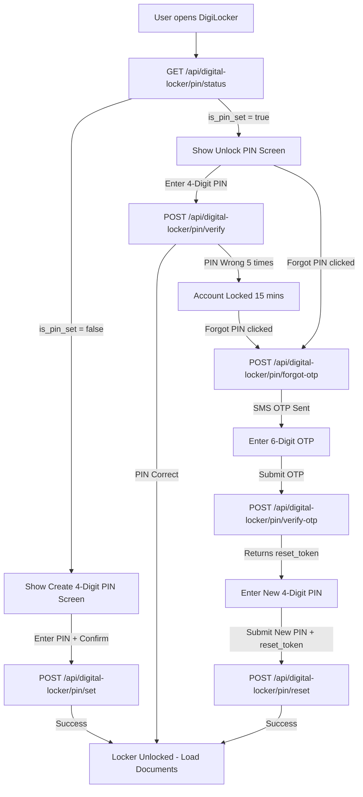

# MediConnect DigiLocker 4-Digit PIN Authentication API Documentation

Complete integration specification for the 4-digit PIN security suite in MediConnect DigiLocker.

---

## 🌐 General Configuration
- **Base URL (Local)**: `http://localhost:3000`
- **Base URL (Production)**: `https://mediconnect.fit` *(or your configured domain)*
- **Content-Type**: `application/json`
- **Authentication**: User context identified via `user_id` (UUID from users table)

---

## 🔄 End-to-End Workflow Diagram



---

## 1. Check PIN Status

Use this endpoint on page/screen load to verify if the user has configured a PIN, if the account is currently locked, and to retrieve the masked phone number for OTP display.

- **URL**: `/api/digital-locker/pin/status`
- **Method**: `GET`
- **Query Params**: `?userId={user_id}`  
  *(Alternative route: `/api/digital-locker/pin/status/{user_id}`)*

### Example Request
```http
GET /api/digital-locker/pin/status?userId=5e8bddf3-524a-4607-bb09-7d5768bd10e7 HTTP/1.1
Host: localhost:3000
Content-Type: application/json
```

### Success Response (`200 OK`)
```json
{
  "success": true,
  "message": "PIN status retrieved successfully.",
  "data": {
    "user_id": "5e8bddf3-524a-4607-bb09-7d5768bd10e7",
    "is_pin_set": true,
    "is_locked": false,
    "remaining_lock_minutes": 0,
    "masked_phone": "+91 ******3210",
    "has_phone": true
  }
}
```

---

## 2. Set 4-Digit PIN (First-Time Setup)

Used when a user has not set a PIN yet (`is_pin_set === false`).

- **URL**: `/api/digital-locker/pin/set`  
  *(Alias: `/api/digital-locker/set-pin`)*
- **Method**: `POST`

### Request Payload
```json
{
  "user_id": "5e8bddf3-524a-4607-bb09-7d5768bd10e7",
  "pin": "1234",
  "confirm_pin": "1234"
}
```

### Fields
| Field | Type | Required | Description |
|---|---|---|---|
| `user_id` | String (UUID) | Yes | User's unique ID |
| `pin` | String | Yes | Exactly 4 numeric digits (`/^\d{4}$/`) |
| `confirm_pin` | String | Yes | Must match `pin` exactly |

### Success Response (`200 OK`)
```json
{
  "success": true,
  "message": "4-digit security PIN set successfully.",
  "data": {
    "is_pin_set": true,
    "user_id": "5e8bddf3-524a-4607-bb09-7d5768bd10e7",
    "updated_at": "2026-11-06T06:28:02.993Z"
  }
}
```

### Error Response (`400 Bad Request`)
```json
{
  "success": false,
  "message": "PIN must be exactly 4 numeric digits."
}
```

---

## 3. Verify PIN (Unlock DigiLocker)

Used when user enters their 4-digit PIN to access DigiLocker.

- **URL**: `/api/digital-locker/pin/verify`  
  *(Alias: `/api/digital-locker/verify-pin`)*
- **Method**: `POST`

### Request Payload
```json
{
  "user_id": "5e8bddf3-524a-4607-bb09-7d5768bd10e7",
  "pin": "1234"
}
```

### Success Response (`200 OK`)
```json
{
  "success": true,
  "message": "DigiLocker PIN verified successfully.",
  "data": {
    "verified": true,
    "is_pin_set": true,
    "user_id": "5e8bddf3-524a-4607-bb09-7d5768bd10e7"
  }
}
```

### Wrong PIN (`400 Bad Request`)
```json
{
  "success": false,
  "message": "Incorrect PIN. 4 attempts remaining.",
  "data": {
    "attempts_remaining": 4
  }
}
```

### Maximum Attempts Exceeded (`429 Too Many Requests` or `400`)
```json
{
  "success": false,
  "message": "Incorrect PIN. Maximum attempts exceeded. DigiLocker is locked for 15 minutes. You can reset your PIN with OTP.",
  "data": {
    "is_locked": true,
    "attempts_remaining": 0,
    "remaining_minutes": 15
  }
}
```

---

## 4. Forgot PIN: Send OTP

Sends a 6-digit OTP to the user's registered mobile number via the InsignSMS gateway.

- **URL**: `/api/digital-locker/pin/forgot-otp`  
  *(Alias: `/api/digital-locker/forgot-pin`)*
- **Method**: `POST`

### Request Payload
```json
{
  "user_id": "5e8bddf3-524a-4607-bb09-7d5768bd10e7"
}
```
*(Optionally, you can also pass `phone_number` if user entered it: `{"user_id": "...", "phone_number": "9876543210"}`)*

### Success Response (`200 OK`)
```json
{
  "success": true,
  "message": "OTP sent successfully to your registered mobile number.",
  "data": {
    "verification_id": "31c22e3d-ca75-4470-967d-336f6c104877",
    "phone_number": "+91 ******3210",
    "raw_phone_suffix": "3210",
    "user_id": "5e8bddf3-524a-4607-bb09-7d5768bd10e7",
    "expires_in_minutes": 10,
    "sms_sent": true
  }
}
```

> **Developer Note**: Save `verification_id` in state. It is required in the next step.

---

## 5. Verify OTP (Receive Reset Token)

Verifies the 6-digit OTP entered by the user and generates a single-use `reset_token` valid for 15 minutes.

- **URL**: `/api/digital-locker/pin/verify-otp`  
  *(Alias: `/api/digital-locker/verify-otp`)*
- **Method**: `POST`

### Request Payload
```json
{
  "verification_id": "31c22e3d-ca75-4470-967d-336f6c104877",
  "otp_code": "123456",
  "user_id": "5e8bddf3-524a-4607-bb09-7d5768bd10e7"
}
```

### Success Response (`200 OK`)
```json
{
  "success": true,
  "message": "OTP verified successfully. You may now set your new 4-digit PIN.",
  "data": {
    "reset_token": "8c130c6b6e8cbe216a8f1509a24d55ef9c01ab43",
    "user_id": "5e8bddf3-524a-4607-bb09-7d5768bd10e7",
    "verified": true,
    "expires_in_minutes": 15
  }
}
```

### Invalid OTP (`400 Bad Request`)
```json
{
  "success": false,
  "message": "Invalid OTP code. Please try again."
}
```

---

## 6. Reset PIN (Save New PIN)

Consumes the verified `reset_token` and updates the user's PIN in AWS RDS. The reset token is automatically cleared upon success.

- **URL**: `/api/digital-locker/pin/reset`  
  *(Alias: `/api/digital-locker/reset-pin`)*
- **Method**: `POST`

### Request Payload
```json
{
  "user_id": "5e8bddf3-524a-4607-bb09-7d5768bd10e7",
  "reset_token": "8c130c6b6e8cbe216a8f1509a24d55ef9c01ab43",
  "new_pin": "7890",
  "confirm_pin": "7890"
}
```

### Success Response (`200 OK`)
```json
{
  "success": true,
  "message": "4-digit security PIN reset successfully.",
  "data": {
    "is_pin_set": true,
    "reset": true,
    "user_id": "5e8bddf3-524a-4607-bb09-7d5768bd10e7"
  }
}
```

---

## 💡 Frontend Code Snippet (JavaScript / TypeScript)

```javascript
// Example helper for unlocking DigiLocker
async function unlockDigiLocker(userId, pin) {
  try {
    const res = await fetch("/api/digital-locker/pin/verify", {
      method: "POST",
      headers: { "Content-Type": "application/json" },
      body: JSON.stringify({ user_id: userId, pin }),
    });
    const result = await res.json();
    if (!result.success) {
      throw new Error(result.message || "Invalid PIN");
    }
    // Successfully unlocked!
    return result.data;
  } catch (err) {
    console.error("Unlock error:", err.message);
    throw err;
  }
}
```

---

## 🛡️ Security Specifications
1. **Hashing Algorithm**: PBKDF2 with SHA-512, 10,000 iterations, and a unique 16-byte cryptographically secure random salt. Plain text PIN is never stored.
2. **Brute-Force Rate Limiting**: Max 5 attempts allowed. Exceeding 5 attempts sets a 15-minute temporary lockout in the database.
3. **Single-Use Reset Token**: Generated only after OTP verification. Consumed immediately upon PIN reset.
4. **Test Accounts**: Test mobile numbers (`9027924662`, `7289043777`, `9876543210`) use test OTP `123456`. Real numbers receive real carrier SMS via InsignSMS gateway.

